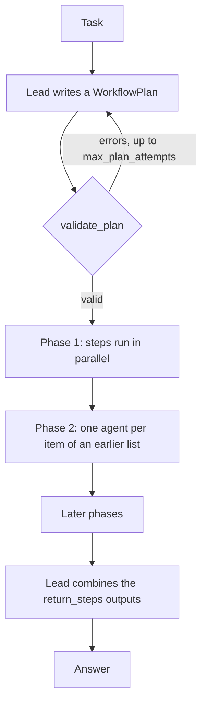

## Overview

`PhasedFanOutWorkflow` hands a task to a lead agent, which writes a plan: phases of steps, where each step is a prompt for one agent. The plan then runs across fresh agents. Phases run in order and the steps of a phase run in parallel. A step can fan out to one agent per item of a list that an earlier step returned, so the width of the run is decided at run time. Finally, the lead reads the outputs of the steps it chose and writes the answer.

The plan is data, not code. The lead returns a `WorkflowPlan` as JSON, and the workflow validates it before any worker step runs. The workflow reads that JSON as workflow data and never evaluates it as code.



Use it when the work splits into units you only know at run time, such as one agent per file, per document or per finding, and you want the lead to choose the shape. When you already know the shape, `SequentialWorkflow`, `ConcurrentWorkflow` or `GraphWorkflow` let you fix it yourself.

<Warning>
In the PyPI releases 16.0.3 and 16.0.4, `plan()` raises `AttributeError` until `run()` has been called, a `plan()` after a run reuses that run's lead with its task, plan and answer still in memory, and two overlapping `run()` calls on one instance can combine with the wrong lead. [kyegomez/swarms#2628](https://github.com/kyegomez/swarms/pull/2628) fixes this. Until a release includes it, install from GitHub:

```bash
pip install git+https://github.com/kyegomez/swarms.git
```

A GitHub install can report the same version number as the last release.
</Warning>

<Note>
`PhasedFanOutWorkflow` ships in `swarms` 16.0.3 and later. It is not exported from the top-level `swarms` package. Import it from `swarms.structs.phased_fan_out_workflow`.
</Note>

`PhasedFanOutWorkflow` emits OpenTelemetry spans: one when it is constructed, and one for each `run()` call. Worker threads carry the tracing context, so each worker's `Agent.run` span nests under the run. See [Telemetry](/deployment/telemetry) to turn tracing off.

## Quickstart

The task asks the lead to plan one agent per file to find bugs, then one independent agent per reported bug to verify it. The lead runs on `model_name` and the inline agents it defines run on `worker_model_name`.

```python
from swarms.structs.phased_fan_out_workflow import (
    PhasedFanOutWorkflow,
)

CODE = {
    "stats.py": "def mean(xs):\n    return sum(xs) / len(xs) - 1\n",
    "users.py": "def find(users, name):\n    for u in users:\n        if u['name'] = name:\n            return u\n",
    "cache.py": "def get(cache, key, default=[]):\n    default.append(key)\n    return cache.get(key, default)\n",
}

task = (
    "Find every bug in these files. Plan one agent per file to find bugs, "
    "then one independent agent per reported bug to verify it, and report "
    "only verified bugs.\n\n"
    + "\n\n".join(f"# {path}\n{code}" for path, code in CODE.items())
)

workflow = PhasedFanOutWorkflow(
    model_name="gpt-5.4",
    worker_model_name="gpt-5.4-mini",
    size_guideline="small",
)
print(workflow.run(task))
print(workflow.usage)
```

## Constructor

<ParamField path="name" type="str" default="PhasedFanOutWorkflow">
  Name of the workflow. It also names the default lead agent, `{name}-lead`.
</ParamField>

<ParamField path="description" type="str" default="A lead agent plans a phased multi-agent run and combines the results.">
  Description of the workflow.
</ParamField>

<ParamField path="lead_agent" type="Optional[Agent]" default="None">
  Agent that plans and combines. When omitted, a lead is built on `model_name` with the built-in lead prompt. Each `run()` and each `plan()` call works with a fresh copy, so the agent you pass is never run itself.
</ParamField>

<ParamField path="model_name" type="str" default="gpt-5.4">
  Model for the default lead agent.
</ParamField>

<ParamField path="agents" type="Optional[List[Agent]]" default="None">
  Predefined agents a plan may use. Their names must be unique, and each one's `agent_description` is shown to the lead. Every use gets a fresh copy.
</ParamField>

<ParamField path="allow_inline_agents" type="bool" default="True">
  Whether the plan may define its own agents, each with a name and a system prompt.
</ParamField>

<ParamField path="worker_model_name" type="Optional[str]" default="None">
  Model for inline agents. Defaults to the lead's `model_name`.
</ParamField>

<ParamField path="max_agents" type="int" default="1000">
  Hard limit on the worker slots one run schedules: one per step and one per fan-out item. See [Execution and limits](#execution-and-limits).
</ParamField>

<ParamField path="max_concurrent_agents" type="int" default="16">
  Agents that may run at the same time within a phase, from 1 to 256.
</ParamField>

<ParamField path="size_guideline" type="str" default="medium">
  `small`, `medium`, `large` or `unrestricted`. Tells the lead how many agents to aim for; see [Size guidelines](#size-guidelines).
</ParamField>

<ParamField path="max_retries" type="int" default="2">
  Retries for a failed agent before its step fails. Each retry uses a fresh agent.
</ParamField>

<ParamField path="max_plan_attempts" type="int" default="3">
  Plans the lead may write before the run gives up.
</ParamField>

<ParamField path="output_type" type="OutputType" default="final">
  Format of the value `run()` returns. With `final`, that is the lead's answer.
</ParamField>

**Raises:**

| Exception | Condition |
|---|---|
| `ValueError` | `max_agents` is below 1, `max_concurrent_agents` is outside 1 to 256, `size_guideline` is unknown, `max_retries` is below 0 or `max_plan_attempts` is below 1 |
| `ValueError` | Two predefined agents share a name |
| `ValueError` | There are no predefined agents and `allow_inline_agents=False` |

## Methods

### run()

Plans the task, runs the plan's phases and returns the combined result.

```python
def run(self, task: str, img: Optional[str] = None) -> Any: ...
```

**Parameters:**
- `task` (str): The task. Steps receive it through the `{task}` placeholder.
- `img` (str, optional): An image passed to the lead when it plans.

**Returns:** The run's conversation, formatted by `output_type`. It holds the task, the plan, every step's output (labelled `<phase title> / <step id>`) and the lead's answer. With the default `final`, `run()` returns the answer.

**Raises:**
- `PhasedFanOutWorkflowError`: No valid plan was written within `max_plan_attempts`, a phase would pass `max_agents`, a fan-out source is not a list, or a single (non fan-out) step failed after its retries.
- An exception raised by the lead itself, while planning or combining, propagates unchanged.

Each call plans and combines with its own fresh copy of the lead, and records the run in `last_plan` and `last_run`.

### plan()

Asks a fresh copy of the lead for a plan and validates it, sending a rejected plan back to the lead with its errors.

```python
def plan(self, task: str, img: Optional[str] = None) -> WorkflowPlan: ...
```

**Parameters:**
- `task` (str): The task to plan for.
- `img` (str, optional): An image passed to the lead.

**Returns:** A `WorkflowPlan` that passed `validate_plan`.

**Raises:**
- `PhasedFanOutWorkflowError`: No valid plan was written within `max_plan_attempts`.
- An exception raised by the lead itself propagates and is not retried.

`plan()` runs no worker steps and does not combine, but it is not free. Each attempt is one `run()` call on the lead, and that call can make several model calls through agent loops, tools or retries. `run()` plans again on its own, so a plan from `plan()` can't be passed to `run()`; use it to see what the lead would do. Standalone calls are not recorded in `last_plan`, `last_run` or `usage`.

### validate_plan()

Checks a plan before any worker step runs. `plan()` uses it, and you can call it on a plan you build yourself.

```python
def validate_plan(self, plan: WorkflowPlan) -> List[str]: ...
```

**Returns:** The problems found, or an empty list when the plan is valid. See [Validation rules](#validation-rules).

## Inspecting a run

| Attribute | Description |
|---|---|
| `last_plan` | The `WorkflowPlan` of the most recent run. It is `None` until that run's plan passes validation. |
| `last_run` | A dict for the most recent run, described below. |
| `usage` | A property: provider token counts summed over `last_run["agents"]`, in the shape of `Agent.usage`. |

`last_run` holds:

| Key | Description |
|---|---|
| `task` | The task. |
| `outputs` | Each step's output by step id. A fan-out step's output is a list with one entry per item, and `None` for an item whose agent failed. |
| `failures` | One record per step or fan-out item that still failed after its retries: `phase`, `step`, `item` and `error`. |
| `agent_count` | Worker slots scheduled so far. |
| `agents` | Every agent instance the run used, the lead first, including instances whose attempts failed. |
| `answer` | The lead's answer. Set only after combining succeeds. |
| `usage` | The token counts at the end of the run. Set only after combining succeeds. |

<Note>
Each `run()` plans and combines with its own copy of the lead, so every call returns its own answer even when calls overlap on one instance. `last_plan`, `last_run` and `usage` belong to the instance, though: when runs overlap, they describe whichever run set them last. Use one instance per concurrent run if you rely on them.

An `Agent` is copied by rebuilding it from its constructor arguments. Those are shared by reference, except that an `llm` that is a `LiteLLM` client is left out so the copy builds its own. Other agent-like objects are deep-copied. A lead with `persistent_memory=True` keeps one `MEMORY.md` for all its copies, because they share its `agent_name`.
</Note>

## The plan

The lead returns a `WorkflowPlan`:

| Field | Type | Default | Description |
|---|---|---|---|
| `name` | `str` | required | A short name for the plan |
| `description` | `str` | required | One sentence on the approach |
| `inline_agents` | `List[InlineAgentSpec]` | `[]` | Agents defined for this run, each with a `name` and a `system_prompt` |
| `phases` | `List[Phase]` | required | Phases, run in order |
| `return_steps` | `List[str]` | required | Step ids whose outputs the lead reads to write the answer |

A `Phase` has a `title` and a list of `steps`, which run in parallel. Each `Step` has:

| Field | Type | Default | Description |
|---|---|---|---|
| `id` | `str` | required | Unique step id |
| `agent` | `str` | required | Name of a predefined or inline agent |
| `prompt` | `str` | required | The agent's full instructions, with placeholders |
| `for_each` | `Optional[str]` | `None` | `"<step_id>.<field>"`: run one agent per item of that list |
| `output_schema` | `Optional[Dict[str, Any]]` | `None` | JSON schema the agent is asked to follow |

### Placeholders

Each agent sees only its system prompt and its step prompt, so a step prompt passes material in through placeholders:

- `{task}` is replaced with the original task, word for word.
- `{step_id}` is replaced with the output of that step, which must be in an earlier phase. Structured outputs are inserted as JSON.
- `{item}` is replaced with the current item, in a `for_each` step only. Objects are inserted as JSON.

### Fan-out

`for_each: "<step_id>.<field>"` runs one agent per element of a list. The source step must be in an earlier phase and must declare an `output_schema` whose `properties` include that field, with type `array` or with no type. If the source is itself a fan-out, the lists from all its slots are joined into one, skipping failed slots. If a source's output has no list at that field when the step runs, the run raises `PhasedFanOutWorkflowError`.

### Structured output

When a step has an `output_schema`, its prompt asks for JSON matching the schema, and the reply is parsed as JSON. Code fences and prose around the JSON are tolerated. The reply is not validated against the schema.

## Validation rules

`validate_plan` rejects a plan when:

- it defines inline agents while `allow_inline_agents=False`, repeats an inline agent name, or reuses a predefined agent's name;
- it has no phases, or a phase has no steps;
- a step id is used twice, or is `item` or `task`;
- a step names an agent that doesn't exist;
- a step prompt has no `{task}`, `{item}` or `{step_id}` placeholder, so its agent would see none of the task's material;
- `{item}` appears outside a `for_each` step, or `{step_id}` names a step that is not in an earlier phase;
- a `for_each` is not `"<step_id>.<field>"`, or its source is not in an earlier phase, or the field is not declared in the source's `output_schema`, or the field is declared with a type other than `array`;
- two steps in one phase have the same agent, prompt and `for_each`, so they would do the same work;
- `return_steps` is empty or names an unknown step;
- the steps that don't fan out already number more than `max_agents`.

A rejected plan goes back to the lead with the reasons, up to `max_plan_attempts`. After that, the run raises `PhasedFanOutWorkflowError`.

## Execution and limits

- Phases run in order. The steps of a phase start together, with at most `max_concurrent_agents` running at once.
- Every step runs in a new agent instance. A predefined agent is copied for each use, and an inline agent is built on `worker_model_name`.
- Outputs move between phases in code, not through the lead. The lead reads only the `return_steps` outputs, when it combines.
- `max_agents` caps the worker slots a run schedules: one per step and one per fan-out item. The plan's fixed steps are checked during validation, and every phase is checked before it starts, so a fan-out that would pass the limit stops before any of its agents start. Retry instances and the lead don't count toward it.

## Failures and errors

- A failed agent is retried up to `max_retries` times, each time with a fresh instance.
- If a fan-out agent still fails, its slot becomes `None`, the failure is recorded in `last_run["failures"]`, and the run continues.
- If a single (non fan-out) step still fails, the run raises `PhasedFanOutWorkflowError` once the rest of its phase has finished.
- An exception raised by the lead propagates unchanged.

## Size guidelines

`size_guideline` adds one sentence to the planning prompt. It is guidance for the lead; `max_agents` is the limit that is enforced.

| Value | Guideline |
|---|---|
| `small` | Aim for fewer than 5 agents in total. |
| `medium` | Aim for fewer than 10 agents in total. |
| `large` | Aim for fewer than 50 agents in total. |
| `unrestricted` | Use as many agents as the task needs, within the hard limit. |

## Examples

### Review contracts with predefined agents

With `allow_inline_agents=False`, the lead must build its plan from the agents you pass. Here they are a reader that quotes candidate clauses and a checker that verifies a quoted clause.

```python
from swarms import Agent
from swarms.structs.phased_fan_out_workflow import (
    PhasedFanOutWorkflow,
)

CONTRACTS = {
    "acme_supply.txt": "If Supplier undergoes a change of control, Buyer may terminate this Agreement on 30 days' notice.",
    "globex_license.txt": "This license is non-transferable. Licensee may not assign this license without prior written consent.",
    "initech_services.txt": "Either party may terminate for convenience with 90 days' notice. Fees are payable monthly in arrears.",
    "umbrella_lease.txt": "A merger, acquisition or sale of a majority of Tenant's shares is deemed an assignment requiring Landlord's consent.",
}

reader = Agent(
    agent_name="Clause-Reader",
    agent_description="Reads one contract and quotes any clause triggered by a change of ownership or control.",
    system_prompt="You read a single contract and quote, word for word, every clause that is triggered by a change of control, merger, acquisition or sale of shares. If there is none, say so.",
    model_name="gpt-5.4-mini",
    max_loops=1,
)

checker = Agent(
    agent_name="Clause-Checker",
    agent_description="Independently checks whether a quoted clause really is a change-of-control clause.",
    system_prompt="You are a skeptical contracts lawyer. Given a contract and a quoted clause, decide whether the clause is triggered by a change of control: a merger, an acquisition, or a sale of a controlling stake. A clause that treats such an event as an assignment counts. A plain ban on assignment that never mentions a change of ownership does not. Give a verdict and one sentence of reasoning.",
    model_name="gpt-5.4-mini",
    max_loops=1,
)

task = (
    "Which of these contracts contain a change-of-control clause? "
    "Read each contract separately, then have every candidate clause checked independently.\n\n"
    + "\n\n".join(
        f"# {name}\n{text}" for name, text in CONTRACTS.items()
    )
)

workflow = PhasedFanOutWorkflow(
    model_name="gpt-5.4",
    agents=[reader, checker],
    allow_inline_agents=False,
    size_guideline="small",
)
print(workflow.run(task))
print(workflow.usage)
```

### See the plan first

`plan()` returns the plan the lead writes for a task without running any worker. It still calls the lead, and `run()` plans again.

```python
from swarms.structs.phased_fan_out_workflow import (
    PhasedFanOutWorkflow,
)

workflow = PhasedFanOutWorkflow(
    model_name="gpt-5.4",
    size_guideline="small",
)
plan = workflow.plan(
    "Find every bug in these files and verify each one: ..."
)
for phase in plan.phases:
    print(phase.title, [step.id for step in phase.steps])
```

## Source code

View the [source code on GitHub](https://github.com/kyegomez/swarms/blob/master/swarms/structs/phased_fan_out_workflow.py).
