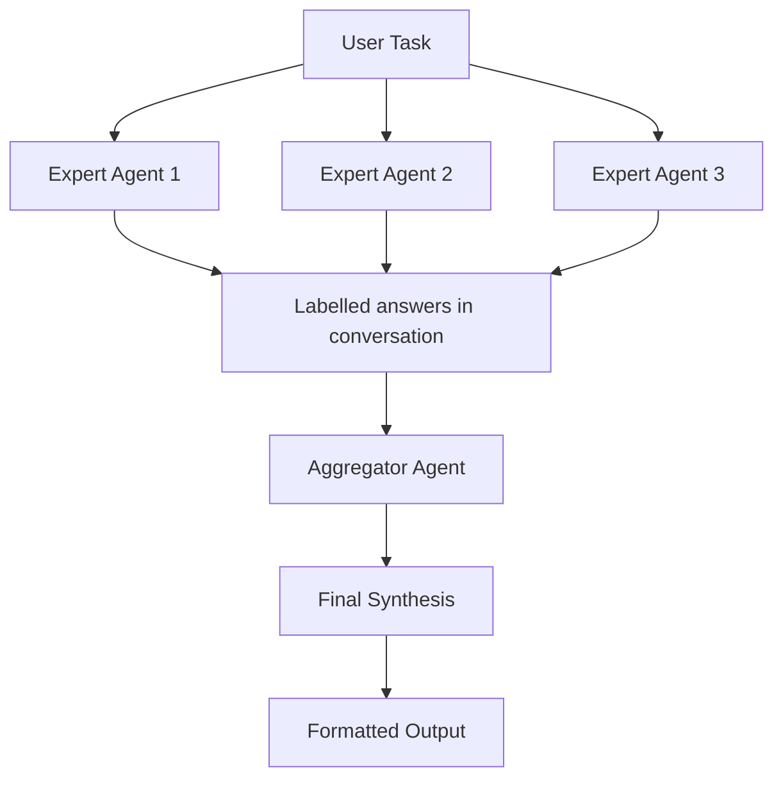

The `MixtureOfAgents` architecture runs multiple expert agents in parallel and synthesizes their diverse outputs through an aggregator agent. This collaborative approach achieves superior results through multi-perspective analysis.

## When to Use

- **Complex problem-solving**: Tasks requiring multiple expert perspectives
- **Quality through collaboration**: Combine diverse viewpoints for better outcomes
- **State-of-the-art performance**: Achieve highest quality through synthesis
- **Expert systems**: Leverage specialized knowledge from multiple domains
- **Comprehensive analysis**: Get well-rounded insights

## Key Features

- Parallel execution of expert agents
- Automatic aggregation and synthesis
- Multi-layer processing (optional)
- Layer-labelled worker answers, so the aggregator knows who said what and in which round
- Flexible output formatting
- Conversation history tracking

## Basic Example

```python
from swarms import Agent, MixtureOfAgents

# Define expert agents
financial_analyst = Agent(
    agent_name="Financial-Analyst",
    system_prompt="Analyze financial data, ratios, and performance metrics.",
    model_name="gpt-5.4",
    max_loops=1,
)

market_analyst = Agent(
    agent_name="Market-Analyst",
    system_prompt="Analyze market trends, competition, and positioning.",
    model_name="gpt-5.4",
    max_loops=1,
)

risk_analyst = Agent(
    agent_name="Risk-Analyst",
    system_prompt="Analyze risks, threats, and mitigation strategies.",
    model_name="gpt-5.4",
    max_loops=1,
)

# Define aggregator agent
aggregator = Agent(
    agent_name="Investment-Advisor",
    system_prompt="Synthesize financial, market, and risk analyses into a comprehensive investment recommendation.",
    model_name="gpt-5.4",
    max_loops=1,
)

# Create MoA swarm
moa = MixtureOfAgents(
    name="Investment-Analysis-Team",
    agents=[financial_analyst, market_analyst, risk_analyst],
    aggregator_agent=aggregator,
    layers=1,  # Single layer of analysis
)

# Execute
recommendation = moa.run("Should we invest in NVIDIA stock?")
print(recommendation)
```

## Multi-Layer Processing

Use multiple layers for iterative refinement:

```python
moa = MixtureOfAgents(
    name="Deep-Analysis-Team",
    agents=[expert1, expert2, expert3],
    aggregator_agent=synthesizer,
    layers=3,  # Three rounds of analysis and synthesis
    max_loops=1,
)

result = moa.run("Complex strategic decision")
```

Each layer:
1. Experts analyze their input, concurrently
2. Each answer is added to the conversation, labelled with the expert and the layer, for example `Market-Analyst (layer 2/3)`
3. The next layer receives the original task plus the previous layer's answers, not the whole transcript

After the last layer, the aggregator reads every labelled answer from every layer and synthesizes the final result.

## Key Parameters

<ParamField path="name" type="str" default="MixtureOfAgents">
  Name for the MoA instance
</ParamField>

<ParamField path="agents" type="List[Agent]" required>
  List of expert agents to run in parallel
</ParamField>

<ParamField path="aggregator_agent" type="Agent" default="None">
  Agent that synthesizes expert outputs. If omitted, a default aggregator is created automatically from `aggregator_system_prompt` and `aggregator_model_name`.
</ParamField>

<ParamField path="layers" type="int" default="3">
  Number of processing layers (iterations)
</ParamField>

<ParamField path="max_loops" type="int" default="1">
  Stored for compatibility with other swarm classes. It does not change execution; use `layers` for more rounds
</ParamField>

<ParamField path="output_type" type="OutputType" default="final">
  Output format (final, all, list, dict)
</ParamField>

<ParamField path="aggregator_system_prompt" type="str" default="AGGREGATOR_SYSTEM_PROMPT_MAIN">
  System prompt for the automatically created aggregator. Ignored when you pass your own `aggregator_agent`
</ParamField>

<ParamField path="aggregator_model_name" type="str" default="claude-sonnet-4-20250514">
  Model for the aggregator agent
</ParamField>

<ParamField path="max_workers" type="int" default="None">
  Cap on how many worker agents run concurrently within a single layer. Forwarded to `run_agents_concurrently()`. When omitted, the pool uses 95% of the available CPU cores.
</ParamField>

<ParamField path="aggegrator_args" type="Dict[str, Any]" default="None">
  Extra `Agent` keyword arguments forwarded to the **automatically created** aggregator. Ignored entirely when you pass your own `aggregator_agent`.
</ParamField>

<Warning>
  The parameter is spelled `aggegrator_args` in the code — note the transposed letters. That misspelling is the name you must type; `aggregator_args` is not accepted and raises `TypeError`.
</Warning>

<ParamField path="channel" type="CommsChannel" default="None">
  A comms channel the mixture posts to: the task, each worker's answer per layer, then the aggregator's answer. See [Comms Channels](/api/channels/overview).
</ParamField>

## Methods

### run()

Execute the mixture of agents with a task.

```python
result = moa.run(
    task="Analyze investment opportunity",
    img=None,  # Optional image input
)
```

Each call starts a fresh conversation and resets every worker's memory, so a reused mixture does not carry an earlier task into the next one. If the aggregator fails, `run()` raises its exception rather than returning it as the answer. A failing worker does not stop the run: its exception is recorded as that worker's answer.

### run_batched()

Process multiple tasks sequentially.

```python
tasks = [
    "Analyze tech sector",
    "Analyze healthcare sector",
    "Analyze energy sector"
]

results = moa.run_batched(tasks)
```

### run_concurrently()

Process multiple tasks in parallel. Results come back in task order.

```python
tasks = ["Task 1", "Task 2", "Task 3"]
results = moa.run_concurrently(tasks)
```

<Warning>
  Every task runs on the same instance, conversation and worker agents, so concurrent tasks can overwrite each other's state. Prefer `run_batched()`, or one `MixtureOfAgents` per task, when results must stay isolated.
</Warning>

## Use Cases

### Investment Analysis

```python
# Multiple financial experts with synthesis
value_investor = Agent(agent_name="Value-Investor", ...)
growth_investor = Agent(agent_name="Growth-Investor", ...)
momentum_trader = Agent(agent_name="Momentum-Trader", ...)
aggregator = Agent(agent_name="Portfolio-Manager", ...)

investment_moa = MixtureOfAgents(
    agents=[value_investor, growth_investor, momentum_trader],
    aggregator_agent=aggregator,
)

advice = investment_moa.run("Evaluate Tesla for our portfolio")
```

### Medical Diagnosis

```python
# Multiple specialists with diagnostic synthesis
cardiologist = Agent(agent_name="Cardiologist", ...)
neurologist = Agent(agent_name="Neurologist", ...)
internist = Agent(agent_name="Internist", ...)
diagnostician = Agent(agent_name="Chief-Diagnostician", ...)

medical_moa = MixtureOfAgents(
    agents=[cardiologist, neurologist, internist],
    aggregator_agent=diagnostician,
)

diagnosis = medical_moa.run("Patient presents with chest pain and dizziness")
```

### Research Synthesis

```python
# Domain experts with research synthesis
ml_researcher = Agent(agent_name="ML-Researcher", ...)
data_scientist = Agent(agent_name="Data-Scientist", ...)
domain_expert = Agent(agent_name="Domain-Expert", ...)
research_lead = Agent(agent_name="Research-Lead", ...)

research_moa = MixtureOfAgents(
    agents=[ml_researcher, data_scientist, domain_expert],
    aggregator_agent=research_lead,
    layers=2,  # Two rounds of analysis
)

insights = research_moa.run("Novel approaches to computer vision")
```

## Custom Aggregator Prompt

`aggregator_system_prompt` configures the aggregator that `MixtureOfAgents` builds for you. If you pass your own `aggregator_agent`, set the prompt on that agent's `system_prompt` instead.

```python
from swarms.prompts.ag_prompt import AGGREGATOR_SYSTEM_PROMPT_MAIN

# Use default prompt
moa = MixtureOfAgents(
    agents=experts,
    aggregator_system_prompt=AGGREGATOR_SYSTEM_PROMPT_MAIN,
)

# Or create custom aggregator prompt
custom_prompt = """
You are a senior investment advisor synthesizing expert analyses.

Your role:
1. Review all expert opinions carefully
2. Identify consensus and conflicts
3. Weight opinions by confidence and evidence
4. Provide clear, actionable recommendations
5. Explain your reasoning and risk factors

Always be conservative and highlight uncertainty.
"""

moa = MixtureOfAgents(
    agents=experts,
    aggregator_system_prompt=custom_prompt,
)
```

## Automatic Aggregator Setup

If no aggregator agent is provided, one is created automatically:

```python
moa = MixtureOfAgents(
    name="Analysis-Team",
    agents=[expert1, expert2, expert3],
    aggregator_model_name="claude-sonnet-4-6",
)

# Automatic aggregator created with:
# - agent_name="Aggregator Agent"
# - system_prompt=AGGREGATOR_SYSTEM_PROMPT_MAIN (or your aggregator_system_prompt)
# - model_name=aggregator_model_name
# - max_loops=1
# - output_type="final"
# - dynamic_context_window=True
```

Use `aggegrator_args` to pass any other `Agent` keyword argument through to that
auto-created aggregator:

```python
moa = MixtureOfAgents(
    name="Analysis-Team",
    agents=[expert1, expert2, expert3],
    aggregator_model_name="claude-sonnet-4-6",
    aggegrator_args={"temperature": 0.2, "max_tokens": 4096},
)
```

<Note>
  `aggegrator_args` only applies when the aggregator is auto-created. If you pass your own
  `aggregator_agent`, configure it on that `Agent` directly — `aggegrator_args` is ignored.
</Note>

## Architecture Flow



## Multi-Layer Flow

With `layers=3`:

```
Layer 1:
  User task → Experts → Conversation, as "Name (layer 1/3)"

Layer 2:
  Task + Layer 1 answers → Experts → Conversation, as "Name (layer 2/3)"

Layer 3:
  Task + Layer 2 answers → Experts → Conversation, as "Name (layer 3/3)"

Final:
  Task + every labelled answer from Layers 1-3, as chat turns → Aggregator → Output
```

With `layers=1` the labels are the plain agent names.

## Output Types

```python
# Only final aggregated output
moa_final = MixtureOfAgents(
    agents=experts,
    aggregator_agent=aggregator,
    output_type="final",
)

# All conversation history
moa_all = MixtureOfAgents(
    agents=experts,
    aggregator_agent=aggregator,
    output_type="all",
)

# Structured dictionary
moa_dict = MixtureOfAgents(
    agents=experts,
    aggregator_agent=aggregator,
    output_type="dict",
)
```

## Best Practices

<Note>
  **Expert Selection**: Choose agents with complementary expertise for maximum benefit
</Note>

1. **Diverse Experts**: Select agents with different perspectives/specializations
2. **Clear Prompts**: Give each expert a specific focus area
3. **Quality Aggregator**: Use a strong model for synthesis (Claude Sonnet, GPT-5.4)
4. **Layer Count**: Start with 1 layer, add more only if needed
5. **Aggregator Instructions**: Provide clear synthesis guidelines

<Warning>
  More experts and layers increase cost and latency - balance quality with efficiency
</Warning>

## Reliability Checks

The system validates configuration on initialization:

```python
try:
    moa = MixtureOfAgents(
        agents=[],  # Empty list
        aggregator_agent=aggregator,
    )
except ValueError as e:
    print(e)  # "No agents provided."
```

Validations:
- At least one expert agent required
- Aggregator system prompt must be provided
- Layers must be specified

## Performance Considerations

### Concurrent Execution

Experts run concurrently on a thread pool:

```python
agent_outputs = run_agents_concurrently(
    agents=self.agents,
    task=task,
    img=img,
    return_agent_output_dict=True,
    max_workers=self.max_workers,
)
```

Only each expert's final answer is recorded, not its whole transcript.

### Conversation Context

Layers do **not** receive the full transcript. The first layer gets the task alone; each later layer gets the original task plus the previous layer's synthesis. This deliberately avoids re-sending a growing transcript to every worker on every layer.

```python
# swarms/structs/mixture_of_agents.py
worker_input = task                       # layer 0

if layer > 0:                             # every later layer
    worker_input = (
        f"Original task: {task}\n\n"
        f"Previous layer synthesis:\n{prev_layer_output}"
    )

step_output = self.step(task=worker_input, img=img)
```

The aggregator is the one agent that sees everything. It receives the conversation as chat turns: the task, then every expert answer from every layer, each labelled with its speaker and layer.

## Related Architectures

- [Concurrent Workflow](/architectures/concurrent-workflow) - Parallel without synthesis
- [Hierarchical Swarm](/architectures/hierarchical-swarm) - Director-worker pattern
- [Heavy Swarm](/architectures/heavy-swarm) - Multi-phase analysis
- [Agent Rearrange](/architectures/agent-rearrange) - Custom flow patterns